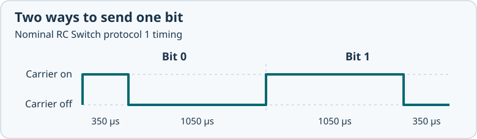

# ESPHome CC1101 Remote

I wanted to make the “dumb” devices I already own smart and keep control of them at home. If you like to tinker, an inexpensive ESP32 board and a CC1101 radio let you build a second remote for a compatible appliance. You can listen to its handheld remote, work out what each button sends, and decide what a dashboard button or automation should do.

I use one board for my backyard string lights and my bedroom ceiling fan. I can schedule the lights to come on at sunset or pick a fan speed from my phone. Home Assistant sends each command over local Wi-Fi through the encrypted ESPHome API, and the CC1101 transmits it by radio. The command stays in my home, so control works even when the internet is down, without relying on a third-party web service.

| Home Assistant device | Radio | Controls |
| --- | --- | --- |
| [Backyard String Lights](#backyard-string-lights) | 433.92 MHz, ASK/OOK, RC Switch protocol 1 | Separate ON and OFF commands |
| [Minka Aire DL-4111G-01](#minka-aire-dl-4111g-01) | 303.875 MHz, ASK/OOK, 12-bit frames | Stop, three fan speeds, light toggle, hold to dim or brighten |

Both handheld remotes still work. These appliances send no state feedback, so Home Assistant shows the last command it sent and can get out of sync after a handheld button press. The [controller configuration](outdoor-string-lights.yaml) contains both examples. For a different remote, start with the receiver and compare several presses of each button before configuring transmission.

## 1. Connect the radio

Use an ESP32-WROOM-32 development board, a USB **data** cable, and a CC1101 module with an antenna suited to your frequency. Unplug USB while wiring. Check the labels on your module and use **3.3 V** for VCC.

| CC1101 | ESP32 | Function |
| --- | --- | --- |
| VCC | 3V3 | Radio power |
| GND | GND | Common ground |
| SCK | GPIO18 | SPI clock |
| SI / MOSI | GPIO23 | SPI data to radio |
| SO / MISO | GPIO19 | SPI data from radio |
| CSN / CS | GPIO5 | SPI chip select |
| GDO0 | GPIO4 | Transmit pulses |
| GDO2 | GPIO27 | Receive pulses |

## 2. Check the connection

Work on the computer connected to the ESP32. If you already have a checkout, open a terminal in its root directory. Otherwise, clone it once.

```sh
git clone https://github.com/rachitshukla/esphome-cc1101-remote.git
cd esphome-cc1101-remote
```

For manual setup, choose [macOS or Linux](#macos-or-linux-terminal) or [Windows PowerShell](#windows-powershell). I tested the hardware workflow on an Intel Mac. Linux and Windows still need hardware verification.

### Start with Claude Code or Codex

If you prefer guided setup, launch `claude` or `codex` in the checkout and use this prompt:

> Follow the repository instructions to identify my board, verify SPI, and capture my remote. Before each upload, show me the target and ask for approval. Tell me when to press each button and where to enter credentials locally.

### macOS or Linux terminal

Install Git, Make, a C++17 compiler, and Python with virtual environment support. The tested interpreters were Python 3.13.13 for ESPHome and 3.9.6 for the diagnostic. If needed, override the Make defaults with `make setup ESPHOME_PYTHON=python3.13 DIAGNOSTIC_PYTHON=python3.9`.

```sh
make setup
make check
.venv/bin/python -m serial.tools.list_ports -v
```

Compare the port list before and after plugging in the board. Set `PORT` to the new entry and keep this terminal open. The identity check resets the ESP32 and reports its chip and flash size.

```sh
# Set this to your port, e.g. /dev/cu.usbserial-0001 on macOS or /dev/ttyUSB0 on Linux.
PORT=/dev/cu.usbserial-0001
.venv/bin/python -m esptool --port "$PORT" --no-stub flash_id
```

**Each upload replaces the firmware on that board.** Once you have confirmed its identity and are ready to install the SPI diagnostic, run:

```sh
.venv/bin/pio run -t upload --upload-port "$PORT"
.venv/bin/pio device monitor --port "$PORT" --baud 115200
```

If Linux reports a serial permission error, check your account’s device-group access. [Espressif serial connection guide](https://docs.espressif.com/projects/esp-idf/en/stable/esp32/get-started/establish-serial-connection.html)

### Windows PowerShell

Install [Git for Windows](https://git-scm.com/downloads/win) and [Python](https://www.python.org/downloads/windows/) with the `py` launcher and the 3.13 and 3.9 interpreters. From the checkout, run:

```powershell
py -3.13 -m venv .venv-esphome
.\.venv-esphome\Scripts\python.exe -m pip install -r requirements-esphome.txt
py -3.9 -m venv .venv
.\.venv\Scripts\python.exe -m pip install -r requirements-diagnostic.txt
.\.venv\Scripts\python.exe -m serial.tools.list_ports -v
```

Compare ports before and after connecting the board. Replace `COM3` with your port and keep this window open for capture.

```powershell
$Port = 'COM3'
.\.venv\Scripts\python.exe -m esptool --port $Port --no-stub flash_id
```

Confirm the chip and flash size. When you are ready to replace the board’s firmware with the SPI diagnostic, run:

```powershell
.\.venv\Scripts\pio.exe run -t upload --upload-port $Port
.\.venv\Scripts\pio.exe device monitor --port $Port --baud 115200
```

### Verify the CC1101

The [diagnostic](src/main.cpp) prints `PARTNUM`, `VERSION`, and register test results. Look for **`PASS: CC1101 SPI reads and writes verified`**. This confirms repeatable SPI reads and successful write/readback. If it fails, check 3.3 V, common ground, and the four SPI connections. Close the serial monitor with Ctrl+C before opening the port with another tool.

## 3. Capture a button press

Set the [USB listener](rf-receive.yaml) to your remote’s labeled frequency. The example below uses 433.92 MHz and the listener’s default ASK/OOK modulation. Uploading the listener replaces the SPI diagnostic.

**macOS or Linux**

```sh
FREQ=433.92MHz
.venv-esphome/bin/esphome -s rx_frequency "$FREQ" compile rf-receive.yaml
.venv-esphome/bin/esphome -s rx_frequency "$FREQ" upload rf-receive.yaml --device "$PORT"
.venv/bin/python record.py "$PORT" lights-on
```

**Windows PowerShell**

```powershell
$Freq = '433.92MHz'
.\.venv-esphome\Scripts\esphome.exe -s rx_frequency $Freq compile rf-receive.yaml
.\.venv-esphome\Scripts\esphome.exe -s rx_frequency $Freq upload rf-receive.yaml --device $Port
.\.venv\Scripts\python.exe record.py $Port lights-on
```

1. Record a few seconds of quiet, then tap **ON** five times, about two seconds apart. Stop with Ctrl+C.
2. Run the recorder again with the label `lights-off` and repeat for **OFF**. For a fan, label each speed, stop, light tap, and light hold separately.
3. Open the timestamped logs in `captures/`. Compare `Received RCSwitch` lines across independent presses and preserve leading zeros. If the decoder finds no match, compare raw pulse timings and signal strength against the quiet baseline. [ESPHome receiver documentation](https://esphome.io/components/remote_receiver/)

**Unknown frequency?** The [frequency survey](rf-survey.yaml) reports approximate signal strength at 303.875, 304, 315, 433, and 433.92 MHz. A repeatable rise during a press gives you a candidate to check with the listener. The [LAN listener](rf-receive-lan.yaml) also supports tuning from Home Assistant through the `tune_receiver` action, which takes integer Hz.

## 4. Put the control in Home Assistant

1. Configure the [controller](outdoor-string-lights.yaml) with the frequency, protocol, codes, and repeats verified for your appliance. For another RC Switch device, reuse the [transmit action](packages/send-rc-switch.yaml). The Minka fan uses its own raw waveform.
2. Create an untracked `secrets.yaml` beside the controller with `wifi_ssid`, `wifi_password`, and `string_lights_api_key`. Generate the key locally with `openssl rand -base64 32` on macOS/Linux or `py -3.13 -c "import base64,secrets; print(base64.b64encode(secrets.token_bytes(32)).decode())"` in PowerShell.
3. When ready to replace the listener, run `.venv-esphome/bin/esphome run outdoor-string-lights.yaml --device "$PORT"` on macOS/Linux or `.\.venv-esphome\Scripts\esphome.exe run outdoor-string-lights.yaml --device $Port` in PowerShell.
4. In Home Assistant, open **Settings → Devices & services → Add integration → ESPHome**. Select the discovered controller or enter `string-lights-radio.local`, then enter the same encryption key. Alternate commands between the two devices and watch each appliance respond. [ESPHome pairing guide](https://www.home-assistant.io/integrations/esphome/#configuration)

The controller suggests **Backyard** for the string lights and **Primary Bedroom** for Minka Aire. If Home Assistant already assigned a room, edit the device’s area and check for an entity-level override.

## Captures and controls

### Backyard string lights

At 433.92 MHz, all five independent taps of each button decoded to the same 32-bit message for that button. The controller sends five repeats using RC Switch protocol 1. [Captured codes and repeat settings](tests/fixtures/string-lights.json)

| Button | Captured message |
| --- | --- |
| ON | `00110010010011111001110000011101` |
| OFF | `00110010010011111010001100100100` |



### Minka Aire DL-4111G-01

**Fan.** Stop turns off the fan while leaving the light alone. Speeds 1, 2, and 3 each start the fan at the selected speed. All three speeds were confirmed on the appliance.

**Light.** A tap on either handheld light button toggles power. Holding one button brightens and holding the other dims. The brightness wraps at each end. The receiver provides no absolute brightness reading. Use the Home Assistant Tile card for power. For hold controls, install **Button Card** through HACS and paste the [fan-light card](docs/dashboard/minka-light.yaml) into a manual dashboard card. Adjust its light entity ID to match your installation.

**Capture.** At 303.875 MHz, five taps per button yielded a dominant 12-bit ASK/OOK frame. The eight leading address bits were zero on this remote. The hex commands were `00A` (stop), `002` (low), `004` (medium), `008` (high), `005` (dim), and `009` (brighten). Holds repeated the command and ended with zero frames. The transmitter uses 330/670 µs pulse widths, an 11.7 ms gap, seven command frames per tap, and two zero frames on release. [Waveform implementation](packages/minka.h)

**Dashboard hold behavior.** With the lamp on, hold **Dim** or **Brighten** and release at the desired level. The controller ignores touches under 250 ms and releases after about six seconds if the release event is lost. On the handheld, three brighten cycles took about six seconds. The dashboard’s press-and-release timing still needs a physical check. [ESPHome controls](packages/minka.yaml) · [Button Card momentary actions](https://github.com/custom-cards/button-card/blob/master/docs/source/config/main.md)

## Working on the code

Run `make setup` once and `make check` for configuration and host regression tests. `make verify` also builds all four ESPHome targets and the SPI diagnostic. Both checks use isolated test credentials and work with the board unplugged. On Windows, run the contributor checks in WSL 2 with its own checkout and Python environments. [Contributor instructions](AGENTS.md)

## License

[MIT](LICENSE)
