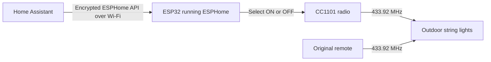
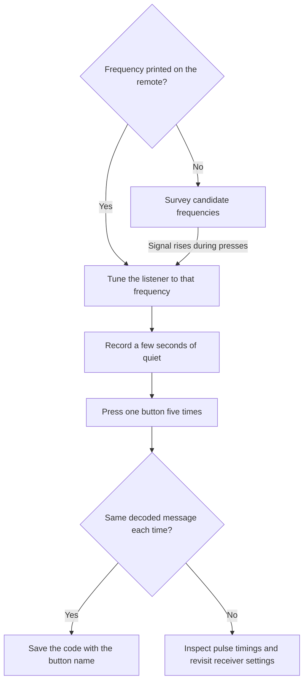

# ESPHome CC1101 Remote

My outdoor string lights already had a perfectly good two-button remote. To bring them into Home Assistant, I built a second remote that speaks the same radio protocol. That gives you a dashboard switch you can use in a [sunset automation](https://www.home-assistant.io/docs/automation/trigger/#sun-trigger), while the original remote still works.

An **ESP32** connects to Home Assistant over Wi-Fi using the [encrypted ESPHome API](https://esphome.io/components/api/). A [CC1101](https://esphome.io/components/cc1101/) is the radio that listens to the original remote and later sends the same kind of signal. Once set up, the whole trip from tapping **ON** to lighting up the porch happens locally.



The lights don’t send an acknowledgment. Home Assistant displays the last command it sent, so using the handheld remote can leave the dashboard out of sync.

## Start with Claude Code or Codex

Once you’ve [wired the CC1101](#1-connect-the-radio) and plugged the ESP32 into USB, open a terminal on **the computer connected to the board**. These two commands work in macOS Terminal, Linux, and Windows PowerShell with Git installed.

```sh
git clone https://github.com/rachitshukla/esphome-cc1101-remote.git
cd esphome-cc1101-remote
```

From that folder, launch your installed coding assistant with `claude` or `codex` and paste this prompt:

> My ESP32 and CC1101 are connected. Help me get my remote working in Home Assistant. Use this repo’s instructions, set up the tools for my computer, and identify my board over USB. Before each upload, show me which board and firmware you picked and ask me first. Verify the radio, then tell me when to press each button. Use what you measure from my remote. When it’s time to pair, show me where to enter my credentials locally.

The first result to expect is a **USB port, ESP32 model, and flash size**. After you approve the diagnostic upload, the assistant can check the radio and report the actual SPI register readings. Both assistants use the same [hardware and credential instructions](AGENTS.md).

**Prefer to run the commands yourself?** [Windows PowerShell](#windows-powershell) · [macOS or Linux](#macos-or-linux-terminal) · [Capture a button](#3-capture-a-button-press) · [Pair with Home Assistant](#4-put-the-control-in-home-assistant)

## Why listen first?

A frequency tells you **where to listen**. The pattern of pulses tells you **which button was pressed**. Two remotes labeled 433.92 MHz can speak different protocols or send different codes. Listening first lets you find out what *your* appliance understands.

Here’s what I heard from the string lights remote using ASK/OOK, a modulation that encodes data by switching the radio carrier on and off:

| Button | Decoded 32-bit message | Independent presses |
| --- | --- | --- |
| ON | `00110010010011111001110000011101` | 5 of 5 matched |
| OFF | `00110010010011111010001100100100` | 5 of 5 matched |

Both messages decoded as [RC Switch protocol 1](https://github.com/sui77/rc-switch/blob/master/RCSwitch.cpp). The diagram shows the protocol’s nominal timing for two example bits. The table above contains the [captured ON and OFF codes](tests/fixtures/string-lights.json).


You can see how the [lights configuration](outdoor-string-lights.yaml) chooses the right message when you tap the switch. For a different light or a ceiling fan, start with a fresh capture.

## 1. Connect the radio

You’ll need an ESP32-WROOM-32 development board, a USB data cable, a [CC1101](https://www.ti.com/product/CC1101) module with an antenna suited to the frequency you want to receive, and jumper wires. With USB unplugged, wire the module by its printed pin labels.

> [!IMPORTANT]
> Use the **3V3** pin to power the CC1101. Check the pin labels on your module before connecting power.

| CC1101 | ESP32 | What the wire does |
| --- | --- | --- |
| VCC | 3V3 | Powers the radio |
| GND | GND | Gives both boards a common ground |
| SCK | GPIO18 | Clocks the SPI connection between the chips |
| SI / MOSI | GPIO23 | Carries settings from ESP32 to radio |
| SO / MISO | GPIO19 | Returns readings from the radio |
| CSN / CS | GPIO5 | Selects the radio for an SPI operation |
| GDO0 | GPIO4 | Carries outgoing pulse data |
| GDO2 | GPIO27 | Carries incoming pulse data |

## 2. Check the connection

### Choose your terminal

Home Assistant can run on a different machine. For setup, use the computer plugged into the ESP32. I tested the full workflow on an Intel Mac. The Linux and Windows instructions still need hardware testing on those platforms.

| Your computer | Where to run the guide | What the USB port often looks like |
| --- | --- | --- |
| macOS | [Terminal](#macos-or-linux-terminal) | `/dev/cu.usbserial-0001` or `/dev/cu.SLAB_USBtoUART` |
| Linux | [Your terminal](#macos-or-linux-terminal) | `/dev/ttyUSB0` or `/dev/ttyACM0` |
| Windows | [PowerShell](#windows-powershell) | `COM3`, `COM4`, or another port in Device Manager |

### Windows PowerShell

Install [Git for Windows](https://git-scm.com/downloads/win) and [Python for Windows](https://www.python.org/downloads/windows/) with the `py` launcher. The following commands use Python 3.13 for ESPHome and 3.9 for the diagnostic, matching the project's tested interpreter versions. Run each command in a regular PowerShell window. Calling the executables directly lets you skip virtual environment activation.

```powershell
git clone https://github.com/rachitshukla/esphome-cc1101-remote.git
cd esphome-cc1101-remote
py -3.13 -m venv .venv-esphome
.\.venv-esphome\Scripts\python.exe -m pip install -r requirements-esphome.txt
py -3.9 -m venv .venv
.\.venv\Scripts\python.exe -m pip install -r requirements-diagnostic.txt
```

Plug in the board. List the ports, replace `COM3` with yours, and check the chip identity. Keep this window open so you can reuse `$Port` later.

```powershell
.\.venv\Scripts\python.exe -m serial.tools.list_ports -v
$Port = 'COM3'
.\.venv\Scripts\python.exe -m esptool --port $Port --no-stub flash_id
```

**Uploading replaces the board's firmware.** After confirming the board, install the SPI diagnostic and open its monitor:

```powershell
.\.venv\Scripts\pio.exe run -t upload --upload-port $Port
.\.venv\Scripts\pio.exe device monitor --port $Port --baud 115200
```

Look for `PASS: CC1101 SPI reads and writes verified`, then close the monitor with Ctrl+C and continue to **3. Capture a button press**.

### macOS or Linux terminal

Install Git, Make, a C++17 compiler, and Python with virtual environment support. My tested versions were Python 3.13.13 for [ESPHome](https://esphome.io/install/) and 3.9.6 for the SPI diagnostic. By default, `make setup` looks for `python3.13` and `python3`. If yours have different names, pass them explicitly, for example `make setup ESPHOME_PYTHON=python3.13 DIAGNOSTIC_PYTHON=python3.9`.

```sh
git clone https://github.com/rachitshukla/esphome-cc1101-remote.git
cd esphome-cc1101-remote
make setup
make check
```

Run this once with the board unplugged and again after connecting it. The new entry is your port.

```sh
.venv/bin/python -m serial.tools.list_ports -v
```

Uncomment the matching `PORT=...` line below, set it to that entry, and reuse it throughout this terminal session. Then use [Espressif’s esptool](https://docs.espressif.com/projects/esptool/en/release-v4/esp32/esptool/basic-commands.html) to read the chip type and flash size.

```sh
# Choose one and substitute the port you found:
# PORT=/dev/cu.usbserial-0001   # macOS
# PORT=/dev/ttyUSB0             # Linux
.venv/bin/python -m esptool --port "${PORT:?Set PORT to your serial device first}" --no-stub flash_id
```

If Linux lists the board but reports “permission denied,” check your account’s serial-device group permissions. [Espressif’s serial connection guide](https://docs.espressif.com/projects/esp-idf/en/stable/esp32/get-started/establish-serial-connection.html)

**Every upload in this guide replaces the firmware on the selected board.** Once you’ve confirmed the port and are ready to replace its firmware, install the [SPI diagnostic](src/main.cpp) and open its USB monitor:

```sh
.venv/bin/pio run -t upload --upload-port "$PORT"
.venv/bin/pio device monitor --port "$PORT" --baud 115200
```

Look for **`PASS: CC1101 SPI reads and writes verified`**. This means the ESP32 read the radio’s identity repeatedly, wrote two test values, and read them back correctly. If it fails, check 3.3 V, common ground, and the four SPI wires before trying to tune the radio. Close the monitor with Ctrl+C so the next tool can use the port.

## 3. Capture a button press



For a labeled remote, try the [USB listener](rf-receive.yaml). Set `FREQ` to the frequency on the label. Compile and upload the listener, then start the recorder. On **macOS or Linux**, use:

```sh
FREQ=433.92MHz
.venv-esphome/bin/esphome -s rx_frequency "$FREQ" compile rf-receive.yaml
.venv-esphome/bin/esphome -s rx_frequency "$FREQ" upload rf-receive.yaml --device "$PORT"
.venv/bin/python record.py "$PORT" lights-on
```

In **Windows PowerShell**, use:

```powershell
$Freq = '433.92MHz'
.\.venv-esphome\Scripts\esphome.exe -s rx_frequency $Freq compile rf-receive.yaml
.\.venv-esphome\Scripts\esphome.exe -s rx_frequency $Freq upload rf-receive.yaml --device $Port
.\.venv\Scripts\python.exe record.py $Port lights-on
```

The [USB recorder](record.py) prints the path to a timestamped file in `captures/`. Leave the remote untouched for a few seconds to get a baseline. Tap **ON** five times, about two seconds apart, then stop recording with Ctrl+C. Repeat with the label `lights-off` and the **OFF** button. Look for the protocol and data in lines containing `Received RCSwitch`. ESPHome’s [receiver documentation](https://esphome.io/components/remote_receiver/) explains the available decoders and raw pulse output. Preserve leading zeros when copying a code.

**No frequency label?** The [frequency survey](rf-survey.yaml) samples a list of candidate frequencies and reports approximate signal strength in dBm. A rise that coincides with several button presses gives you a frequency to investigate. For repeated tuning from Home Assistant, the [LAN listener](rf-receive-lan.yaml) provides a `tune_receiver` action that accepts integer Hz. It uses the local Wi-Fi and encryption settings described below.

## 4. Put the control in Home Assistant

1. Open [the lights controller](outdoor-string-lights.yaml). For your own device, enter the frequency, protocol, and ON/OFF codes from your captures. The tested lights profile sends each command five times.
2. Create an untracked `secrets.yaml` next to the controller file. Set `wifi_ssid`, `wifi_password`, and `string_lights_api_key`. Generate the key locally with `openssl rand -base64 32` on macOS/Linux or `py -3.13 -c "import base64, secrets; print(base64.b64encode(secrets.token_bytes(32)).decode())"` in PowerShell. Home Assistant will ask for the same key when pairing.
3. Install the controller with `.venv-esphome/bin/esphome run outdoor-string-lights.yaml --device "$PORT"` on macOS/Linux or `.\.venv-esphome\Scripts\esphome.exe run outdoor-string-lights.yaml --device $Port` in PowerShell. This replaces the listener and starts the Wi-Fi controller.
4. To pair through the [ESPHome integration](https://www.home-assistant.io/integrations/esphome/#configuration), open **Settings → Devices & services → Add integration → ESPHome**. Select the discovered device or enter `string-lights-radio.local`. Enter the encryption key, then try ON and OFF while watching the actual lights.

**Adding a fan later?** Capture one labeled button at a time. If it uses compatible fixed-code RC Switch messages, add its controls to the same controller using the [shared transmit action](packages/send-rc-switch.yaml). Each command supplies its own frequency so the ESP32 can alternate between the lights and fan. Check both appliances when testing the switch between them.

## Working on the code

The contributor checks use Unix paths and file locking. On Windows, run them in [WSL 2](https://learn.microsoft.com/en-us/windows/wsl/install) with its own checkout and Python environments. These checks can run with the board unplugged.

Run `make check` for configuration checks and host regression tests. Run `make verify` to also compile all four ESPHome targets and the SPI diagnostic. Both use dummy credentials and keep verification artifacts under `.verify/`. Contributor guidance is in [AGENTS.md](AGENTS.md).

## License

[MIT](LICENSE)

## Minka Aire DL-4111G-01

The ESP32 exposes two RF appliances through one encrypted connection. In
**Settings → Devices & services → ESPHome**, look for **Backyard String Lights**
in **Backyard** and **Minka Aire** in **Primary Bedroom**. Minka Aire contains
the three-speed fan and its light. Home Assistant receives the room names as
suggested areas. If an existing assignment takes precedence, edit the device's
area and check for an area override on the entity. After moving existing
entities, check any dashboards or automations that reference them.

Use a Tile card for fan-light power. The physical receiver toggles power on
either button tap. Home Assistant shows the last requested power state.
For manual brightness control, install **Button Card** through HACS and add
the [fan-light card](docs/dashboard/minka-light.yaml) to the bedroom dashboard
using **Edit dashboard → Add card → Manual**. Select your fan-light entity
in the tile if Home Assistant uses a different entity ID. For power alone,
use just the Tile card. Remove any old brightness-slider feature from that tile.

With the lamp on, press and hold **Dim** or **Brighten** while watching the lamp.
Lifting your finger sends the two captured release frames after the active
group finishes. Short touches under 250 ms are ignored. The initial group
lasts about half a second and subsequent groups last about a tenth of a second.
A hold ends automatically after about six seconds if the release is lost.
The handheld remote cycles through brightness in either direction, wrapping at
each end. Three Brighten loops on the handheld took about six seconds.
The dashboard button uses the local ESPHome action for press and release.
See the [Button Card momentary action documentation](https://github.com/custom-cards/button-card/blob/master/docs/source/config/main.md).

The receive-only capture at 303.875 MHz ASK/OOK produced a dominant 12-bit
message across five separate taps for every button. The eight leading address
bits were zero for this remote. Stop, low, medium, high, dim and brighten
ended in A, 2, 4, 8, 5 and 9 respectively (hex). Long presses repeated the
light command and ended with zero frames. The initial transmit settings
use 330/670 microsecond pulses, about 11.7 ms between frames, seven command
frames for a tap, and two trailing zero frames. The owner confirmed fan speed control on the appliance.
The dashboard hold and release need a physical test on the lamp.
